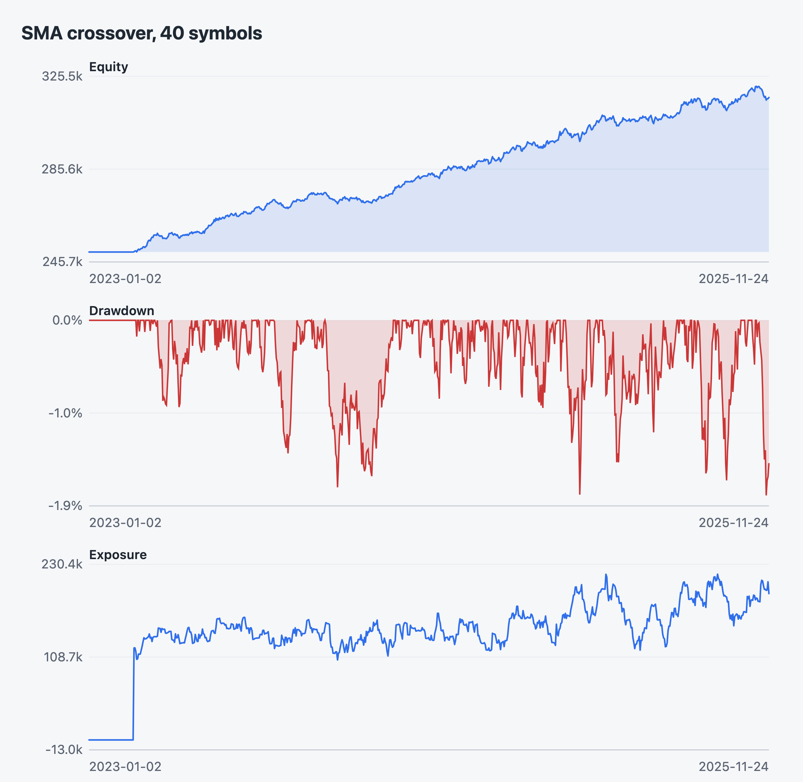
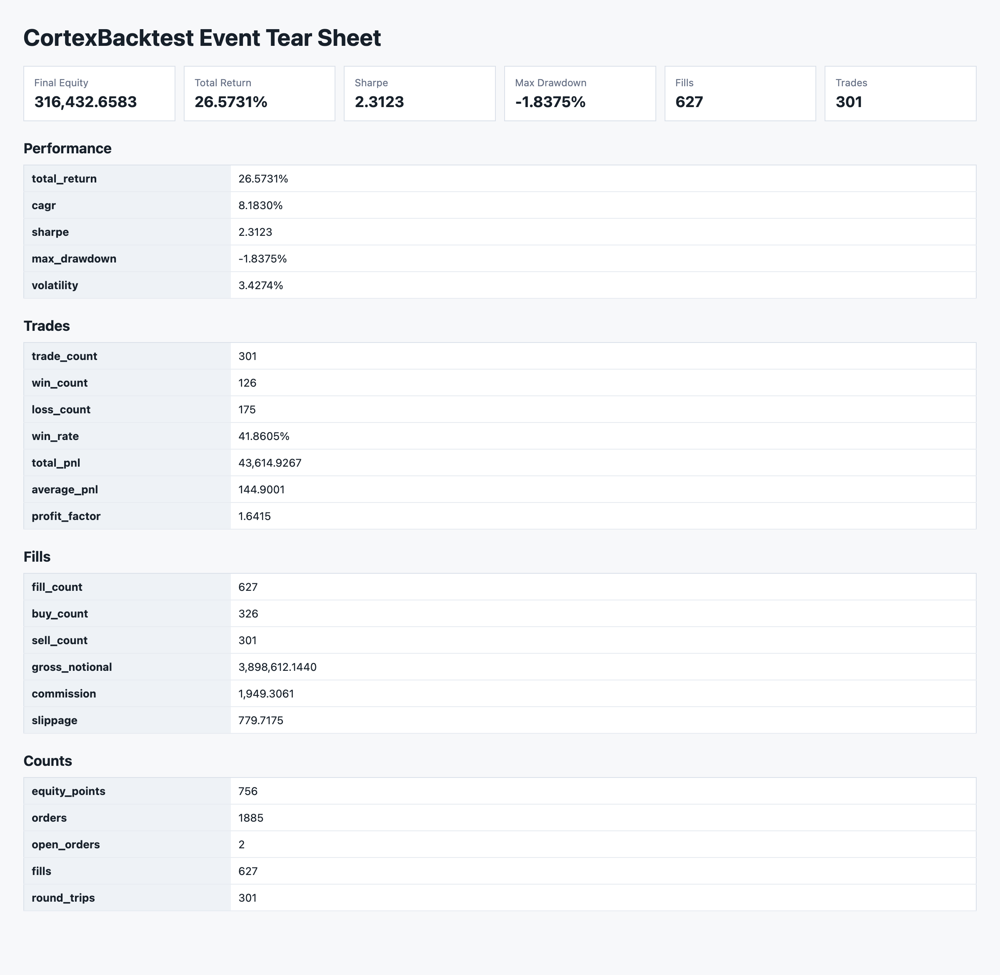
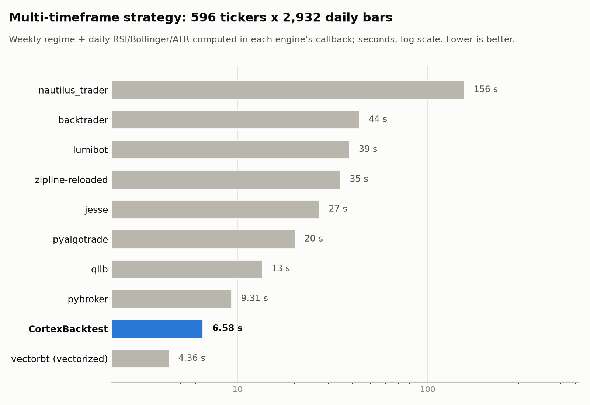
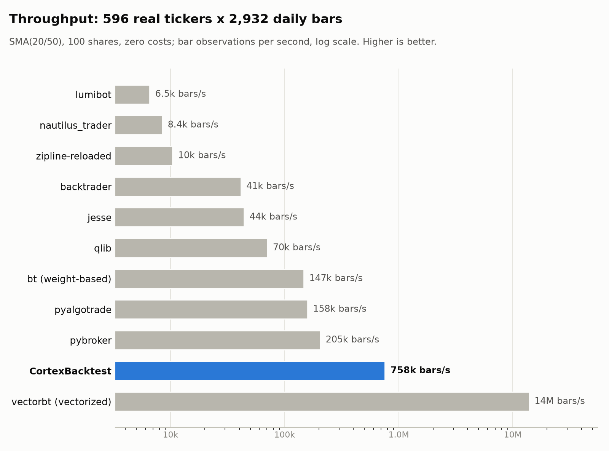
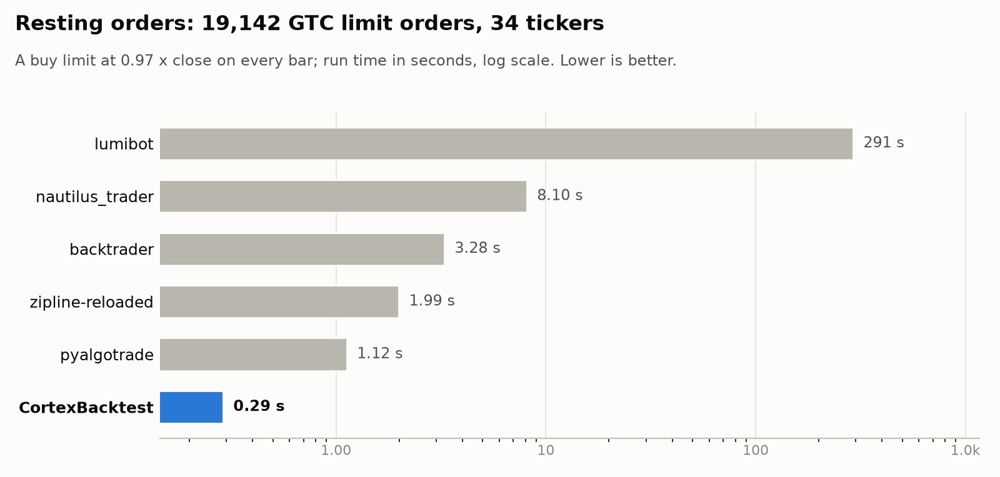

<div align="center">

# CortexBacktest

**Event-driven backtesting and cross-sectional factor research for Python, built on Polars.**

Realistic order execution, explicit fill timing, and results you can reconcile to the cent.

[](pyproject.toml)
[](CHANGELOG.md)
[](LICENSE)
[](https://github.com/DDMYmia/CortexBacktest/actions/workflows/quality.yml)
[](src/cortexbacktest/py.typed)
[](#project-status)

[Quickstart](#quickstart) ·
[Fill timing](#fill-timing) ·
[Benchmarks](#benchmarks) ·
[Documentation](#documentation) ·
[Roadmap](#roadmap)

</div>

---

## Why CortexBacktest

- **One engine for both research styles.** Rank factors cross-sectionally (IC,
  quantile spreads, purged walk-forward splits), then replay the resulting target
  weights through an event-driven broker with real order handling.
- **Execution you can audit.** Market, limit, stop, stop-limit, trailing, OCO and
  bracket orders; partial fills against bar volume; price limits and halts; splits,
  dividends, delistings and mergers; futures variation margin; T+1 settlement.
- **Fill timing is a decision, not an accident.** Next-bar open by default. The
  look-ahead combination (deciding on a bar's close, filling at its open) is
  rejected outright.
- **Reconciled against fifteen other engines.** Every benchmark run's P&L is
  checked against a plain ledger of its fill convention. Engines that share a
  convention agree with CortexBacktest to the cent, apart from engines that round
  prices to a fixed precision.
- **Fast without native code.** 750k bar observations per second on 596 real
  tickers, pure Python on Polars, no Numba or Rust in the hot path.
- **Reproducible.** Run manifests hash the data, broker configuration, strategy
  parameters and code identity.

## Installation

CortexBacktest is not on PyPI yet. Install from source or from a built wheel:

```bash
git clone https://github.com/DDMYmia/CortexBacktest.git && cd CortexBacktest
python3.13 -m venv .venv && source .venv/bin/activate
python -m pip install .
```

Requires Python 3.13. Optional extras: `data` (yfinance/ccxt adapters), `calendar`
(exchange calendars), `analytics`, `optimizer`, `reports`, `ml`, `indicators`, `duck`.

## Quickstart

### An event-driven backtest

```python
from datetime import UTC, datetime, timedelta
from cortexbacktest import Bar, Order, Side, Strategy
from cortexbacktest.api import BacktestConfig, BrokerConfig, run_backtest

class BuyFirstBar(Strategy):
    def on_bar(self, bar):
        if not self.broker.state.positions:
            return [Order(bar.symbol, bar.timestamp, Side.BUY, 100)]
        return []

start = datetime(2024, 1, 2, tzinfo=UTC)
bars = [Bar("SPY", start + timedelta(days=i), 100 + i, 101 + i, 99 + i, 100.5 + i, 1e6) for i in range(10)]

result = run_backtest(bars, BuyFirstBar(), config=BacktestConfig(broker=BrokerConfig(initial_cash=100_000)))
print(result.summary()["final_equity"])  # 100850.0: bought at the next bar's open, marked at the last close
```

### Cross-sectional factor research

```python
import polars as pl
from cortexbacktest import run_factor_research

# Wide frames: one "date" column plus one column per symbol.
prices = pl.read_parquet("prices.parquet")
factors = pl.read_parquet("factors.parquet")

report = run_factor_research(prices, factors, horizons=(1, 5, 20), quantiles=5,
                             top_quantile=0.2, bottom_quantile=0.2, transaction_cost_bps=5.0)
print(report.summary())
print(report.horizon_results[5].mean_rank_ic)
```

More: [`examples/`](examples) has 30+ runnable scripts, and the
[guide](docs/guide.md) covers every example and CLI command.

### Reports

Every run can write a self-contained HTML report (no JavaScript, no plotting
library): equity, drawdown, exposure and return distribution as inline SVG, plus
performance, trade, fill and P&L-reconciliation tables. Regenerate these with
`python examples/showcase_reports.py` (synthetic data, 40 symbols, 3 years).

<p align="center">
  
  
</p>

## Fill timing

A strategy decides on bar T after seeing its close. Each convention is explicit:

| Convention | Settings | When to use |
| --- | --- | --- |
| **Next-bar open** (default) | `trade_on_close=False`, `FillPrice.OPEN` | Daily signals traded at the next session's open |
| Next-bar close | `trade_on_close=False`, `FillPrice.CLOSE` | Matching engines that fill at the next close (zipline) |
| Same-bar close | `trade_on_close=True`, `FillPrice.CLOSE` | Close-auction (MOC) strategies |

`trade_on_close=True` with `FillPrice.OPEN` raises `ValueError`: that price was
gone before the decision was made.

## Benchmarks

Fifteen other Python engines, each in its own interpreter, one machine (Apple
Silicon, CPython 3.11–3.13), zero costs. Every run that states a fill convention
is checked against a plain ledger of that convention: **vs ledger** is the
engine's P&L minus the ledger. Data: 596 real US equities × 2,932 daily bars
(1.75M observations).

### Multi-timeframe, multi-asset strategy

A weekly regime (last completed week above its 10-week mean) gates daily entries
on Wilder RSI(14) or the lower Bollinger(20, 2) band; exits on RSI, the 20-day mean
or the regime; each position is sized from Wilder ATR(14), so every order has its
own share count (32,705 orders). The strategy is computed bar by bar inside every
engine's callback; that shared Python costs about 3.8 s on its own.

<p align="center">
  
</p>

| Engine | Fill convention | Time | Peak RSS | vs ledger |
| --- | --- | ---: | ---: | ---: |
| vectorbt ¹ | next-bar open | 4.4 s | 484 MB | $0.00 |
| **CortexBacktest** | next-bar open | **6.6 s** | 1,122 MB | $0.00 |
| pybroker | next-bar open | 9.3 s | 1,111 MB | $0.00 |
| qlib | next-bar open | 13.5 s | 934 MB | +$0.00 ² |
| pyalgotrade | next-bar open | 20.1 s | 1,076 MB | $0.00 |
| jesse | same-bar close | 26.9 s | 926 MB | $0.00 |
| zipline-reloaded | next-bar close | 34.7 s | 650 MB | +$2.81 ³ |
| lumibot | next-bar open | 38.7 s | 1,196 MB | $0.00 |
| backtrader | next-bar open | 43.7 s | 797 MB | $0.00 |
| nautilus_trader | same-bar close | 156.0 s | 1,343 MB | −$124.12 ⁴ |

### SMA crossover throughput

<p align="center">
  
</p>

SMA(20/50), 100 shares per symbol.

| Engine | Fill convention | Time | Bars/s | Peak RSS | vs ledger |
| --- | --- | ---: | ---: | ---: | ---: |
| vectorbt ¹ | next-bar open | 0.13 s | 13,839,686 | 513 MB | $0.00 |
| **CortexBacktest** | next-bar open | **2.3 s** | **757,683** | 878 MB | $0.00 |
| pybroker | next-bar open | 8.5 s | 204,583 | 877 MB | $0.00 |
| pyalgotrade | next-bar open | 11.0 s | 158,338 | 1,035 MB | $0.00 |
| bt ⁵ | weight-based | 11.9 s | 146,738 | 410 MB | — |
| qlib | next-bar open | 24.8 s | 70,379 | 806 MB | +$0.03 ² |
| jesse | same-bar close | 39.7 s | 43,968 | 795 MB | $0.00 |
| backtrader | next-bar open | 42.4 s | 41,260 | 462 MB | $0.00 |
| zipline-reloaded | next-bar close | 168.0 s | 10,399 | 525 MB | +$0.19 ³ |
| nautilus_trader | same-bar close | 207.2 s | 8,434 | 1,050 MB | +$34.61 ⁴ |
| lumibot | next-bar open | 267.0 s | 6,546 | 1,133 MB | $0.00 |

¹ Vectorized: whole-column arithmetic, no per-bar broker, no resting orders; on
the multi-timeframe strategy the same Python runs as a timed pre-pass.
² Its binary format stores prices as float32. ³ The daily bundle stores prices at
0.001. ⁴ 2-decimal instrument price precision. ⁵ Weight-based rebalancer; not the
same rule, no ledger. backtesting.py and vnpy are single-asset engines and match
the ledger exactly on one symbol; qstrader exceeded the 300 s budget at this size.
freqtrade relabels equities as exchange pairs and has 34 suitable OKX pairs; on 34
tickers it matches the ledger on both strategies.

### Resting orders

<p align="center">
  
</p>

A GTC buy limit at 0.97 × close on every bar, 34 tickers, 19,142 orders.
CortexBacktest, pyalgotrade and backtrader fill the same 16,045 orders.

### Coverage

The most-starred open-source engines on GitHub (November 2026) and where they stand:

| Engine | Stars | Status |
| --- | ---: | --- |
| freqtrade | 56k | included (34 tickers) |
| qlib | 50k | included |
| vnpy | 46k | included (single asset) |
| nautilus_trader | 31k | included |
| backtrader | 24k | included |
| LEAN (QuantConnect) | 22k | not yet: C# engine run through Docker |
| hummingbot | 21k | not applicable: market-making bot without a bar backtester |
| zipline | 20k | included (zipline-reloaded fork) |
| abu, rqalpha | 19k, 7k | not yet: built around China A-share data bundles |
| FinRL | 17k | not applicable: reinforcement-learning environments |
| vectorbt | 9.7k | included |
| backtesting.py | 9.2k | included (single asset) |
| jesse | 8.8k | included |
| wondertrader, hikyuu | 6k, 4k | not yet: C++ engines for China markets |

Also included: pyalgotrade, pybroker, qstrader, bt, lumibot, cipher-bt.
Raw results and rules: [`benchmark-results/competitors-2026-11-05`](benchmark-results/competitors-2026-11-05/README.md)
and [`docs/benchmarks.md`](docs/benchmarks.md). Numbers describe
one machine; rerun the harness before relying on them.

## Architecture

```text
src/cortexbacktest/
  api.py         tier-1 configuration API (run_backtest, BacktestConfig, BrokerConfig)
  event/         event loop, broker, matching, costs, ledger, strategy API
  research/      factor research, preprocessing, validation, portfolio simulation
  execution/     research target weights -> event execution
  datasets/      dataset assembly, schema validation, provenance
  data/          Polars I/O, calendars, universes
  reporting/     records, analyzers, tear sheets, risk and attribution
  adapters/      thin file and DataFrame adapters
  options/       experimental option pricing and quote-driven option backtests
  pipelines/     end-to-end dataset -> research -> event orchestration
```

The public surface is tiered: `cortexbacktest.api` is the versioned contract and
the engine classes are the faster-moving extension layer ([API](docs/api.md)).
Scope is bars and factors in, simulated execution and evaluated results out;
data warehousing, live order routing and product UI are out of scope
([decisions](docs/decisions.md)).

## Documentation

| | |
| --- | --- |
| [Guide](docs/guide.md) | Every example and CLI command, feature inventory |
| [Architecture](docs/architecture.md) | Layers, ownership and data flow |
| [API](docs/api.md) | The tier-1 contract and the import path of every public name |
| [Execution](docs/execution.md) | Fill timing, matching, costs, settlement, futures, search |
| [Factor research workflow](docs/factor-research-workflow.md) | From factor values to evaluated portfolios |
| [Options backtesting](docs/options-backtesting.md) | Experimental option pricing and execution |
| [Benchmarks](docs/benchmarks.md) | The competitor comparison and how to rerun it |
| [All documents](docs/README.md) | Full index |

## Project status

**Alpha (0.0.1).** The configuration API (`cortexbacktest.api`) is versioned; the
extension layer may change between minor versions. See the [changelog](CHANGELOG.md)
for breaking changes; 0.0.1 changed the default fill timing to next-bar open.

## Roadmap

- Publish to PyPI with CI-built wheels.
- Bundled sample dataset so every example runs offline.
- Documentation site generated from the docs folder.
- Rename the remaining project-specific adapter names before 0.1.0.

## Contributing

Issues and pull requests are welcome. Read [CONTRIBUTING.md](CONTRIBUTING.md) first;
security reports go through [SECURITY.md](SECURITY.md).

```bash
python -m pip install -e ".[dev]"
python -m pytest -q
```

## License

[MIT](LICENSE). Third-party notices: [THIRD_PARTY_NOTICES.md](THIRD_PARTY_NOTICES.md).
